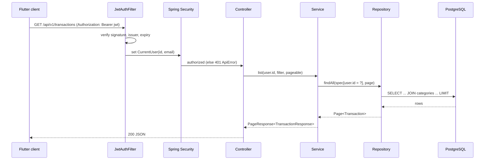
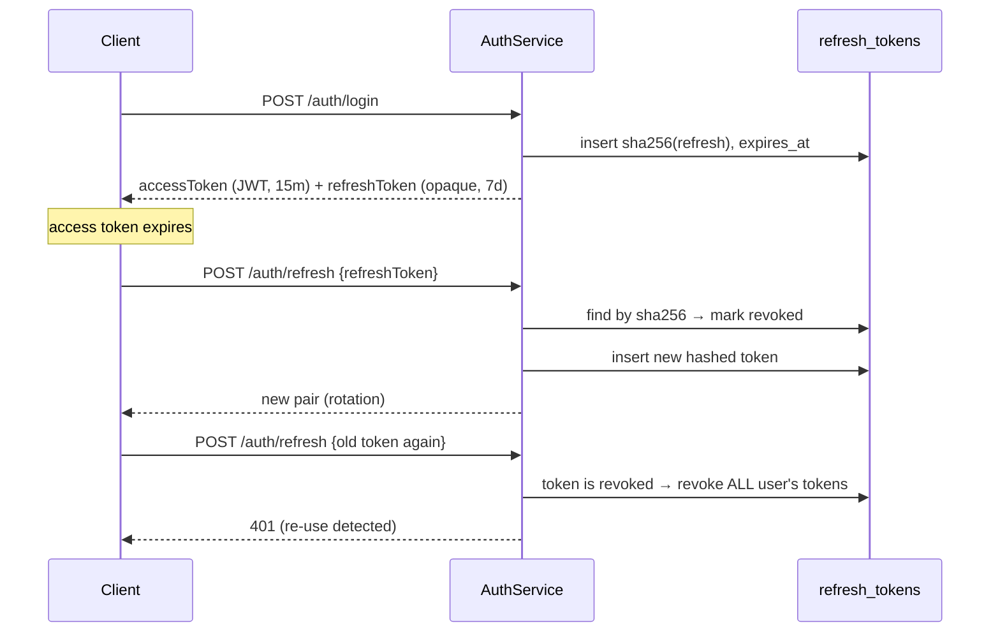

# Architecture

## Tech stack

| Concern | Choice |
|---|---|
| Language / runtime | Java 21 |
| Framework | Spring Boot 4.2 (Spring MVC, Data JPA / Hibernate 7, Validation, Security, Actuator) |
| Database | PostgreSQL 15+ (dev: 16 local or 17 in Docker) |
| Migrations | Flyway (`ddl-auto: validate`) |
| Auth | Stateless JWT (HS512, jjwt) + opaque refresh tokens stored as SHA-256 hashes |
| API docs | springdoc-openapi (Swagger UI, dev only) |
| Tests | JUnit 5, MockMvc, Mockito, Testcontainers / real PostgreSQL |
| Build / CI | Maven wrapper, GitHub Actions, multi-stage Dockerfile |

## Package layout (feature-first)

```
com.example.expensetracker
├── ExpenseTrackerApplication      root package, component-scan base
├── common/                        feature-agnostic
│   ├── config/                    CORS, OpenAPI, JPA auditing, scheduling
│   ├── entity/                    BaseEntity (UUID id, createdAt, updatedAt)
│   ├── exception/                 ApiException hierarchy + GlobalExceptionHandler
│   ├── response/                  ApiError, PageResponse
│   ├── security/                  SecurityConfig, JwtService, JwtAuthFilter, CurrentUser, error handler
│   └── util/                      HashUtils
├── auth/                          register + email OTP / login / forgot + reset password / refresh / logout
├── user/                          profile, password change
├── category/                      defaults + custom categories
├── transaction/                   CRUD, filtering (Specifications), pagination
├── budget/                        monthly budgets with computed spent/remaining
└── report/                        read-only aggregates (no entity)
```

Each feature contains `Controller → Service → Repository`, its entity, a `Mapper` and `dto/` records.
Features may call each other's **services** (e.g. `TransactionService → CategoryService.getUsable`),
never each other's controllers.

## Layer responsibilities

| Layer | Does | Does not |
|---|---|---|
| Controller | HTTP mapping, `@Valid` on DTOs, reads `@AuthenticationPrincipal CurrentUser`, status codes | business rules, repository access |
| Service | business rules, ownership checks, `@Transactional` boundaries, entity ↔ DTO via mapper | HTTP concerns |
| Repository | queries (derived, JPQL, Specifications, `@EntityGraph`) | business rules |
| Mapper | entity → response DTO | lazy loading surprises (callers fetch what is mapped) |

## Request lifecycle



Any exception is turned into the standard `ApiError` JSON by `GlobalExceptionHandler`
(controller layer) or `SecurityErrorHandler` (filter layer).

## Authentication design



- Access token: JWT, HS512, claims `iss`, `sub` (user id), `email`, `iat`, `exp`. Not stored.
- Refresh token: 48 random bytes, Base64URL. Only the SHA-256 hash is stored → a DB leak does not leak usable tokens.
- Password change revokes all refresh tokens.
- A daily job (`AuthCleanupJob`, 03:00) deletes refresh tokens and OTP codes expired for more than a day.

### Email OTP (verification + password reset)

- Register validates the email (strict format + DNS check that the domain can receive mail via
  `EmailDomainChecker`), emails a 6-digit code and stores the details in `pending_registrations`.
  **The `users` row is created only by `/auth/verify-email`** (`RegistrationService`), so a wrong or fake
  email never becomes an account. Login with a pending sign-up's password returns `403 EMAIL_NOT_VERIFIED`
  and emails a fresh code. Registering again replaces the pending details. The email is sent before
  anything is saved, so an SMTP failure changes nothing. Pending sign-ups older than 1 hour are ignored
  and purged every 5 minutes by `AuthCleanupJob`, so the email can register again.
- Auth errors carry exact messages (wrong format, unknown email, incorrect password, attempts left, expired code).
- `SmtpMailService` tests the SMTP login at startup and logs `Mail: SMTP login OK/FAILED`.
- Forgot password: code by email → `/auth/verify-reset-otp` returns a 15-min single-use reset token →
  `/auth/reset-password` sets the password and revokes all refresh tokens.
- `OtpService` stores only `SHA-256(user_id:code)`, invalidates older codes on resend, enforces a 60 s
  resend cooldown and burns a code after 5 wrong guesses. Forgot/resend answer the same for unknown emails.
- Email goes through the `MailService` interface: `SmtpMailService` (`app.mail.enabled=true`) or
  `LoggingMailService` (prints to log, dev). Tests use `CapturingMailService`.
- Passwords: BCrypt (strength 10).

## Data isolation

Every read and write is scoped by the caller's user id inside the service:

| Pattern | Example |
|---|---|
| Lookup by id + owner | `transactionRepository.findByIdAndUserId(id, userId)` |
| Specification root | `TransactionSpecifications.forUser(userId, filter)` always starts with `user.id = :userId` |
| Visibility rule | `CategoryService.getUsable`: system default **or** owned, else 404 |

Someone else's record returns **404** (not 403) so the API does not reveal that an id exists.
Isolation is verified by integration tests for every feature.

## Money and time

- `BigDecimal` everywhere, `NUMERIC(19,2)` in the DB, validated with `@DecimalMin(exclusive)` + `@Digits(fraction = 2)`.
- Report percentages are `BigDecimal` with `HALF_UP` rounding to 2 decimals.
- `transaction_date` is a `LocalDate` (the calendar day the money moved, no time zone).
- Audit timestamps are `Instant` → `TIMESTAMPTZ`; the JDBC session and Jackson are pinned to UTC.

## Error model

| Exception | HTTP | `code` |
|---|---|---|
| Bean validation, malformed JSON, bad query param, `BadRequestException` | 400 | `VALIDATION_ERROR` |
| missing/invalid token, `UnauthorizedException` | 401 | `UNAUTHORIZED` |
| `ForbiddenException` (system category edit) | 403 | `FORBIDDEN` |
| `ResourceNotFoundException`, unknown route | 404 | `NOT_FOUND` |
| `ConflictException`, `DataIntegrityViolationException` | 409 | `CONFLICT` |
| anything else (logged with stack trace server-side) | 500 | `INTERNAL_ERROR` |

## Performance notes

- All list endpoints that can grow are paginated (default 20, max 100).
- `@EntityGraph(attributePaths = "category")` on transaction/budget queries avoids N+1.
- Indexes: `transactions(user_id, transaction_date DESC)`, `transactions(user_id, category_id)`,
  `refresh_tokens(user_id)` plus the unique constraints.
- Reports and budget `spent` are computed with single `GROUP BY` queries in the database.
- `spring.jpa.open-in-view=false`: no lazy loading from controllers.
