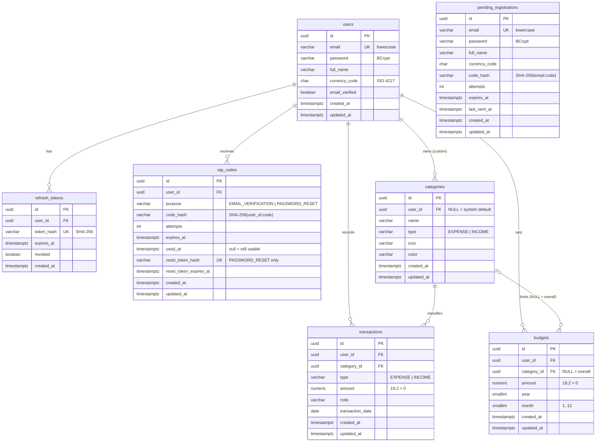

# Database

PostgreSQL 15+. Schema owned **only** by Flyway (`src/main/resources/db/migration`).
Hibernate runs with `ddl-auto: validate` and fails startup if entities and schema disagree.

## ER diagram



## Migrations

| Version | File | Purpose |
|---|---|---|
| V1 | `V1__create_users_table.sql` | users, unique email, lowercase check |
| V2 | `V2__create_refresh_tokens_table.sql` | hashed refresh tokens, cascade on user delete |
| V3 | `V3__create_categories_table.sql` | categories, `UNIQUE NULLS NOT DISTINCT (user_id, name, type)` |
| V4 | `V4__seed_default_categories.sql` | 9 expense + 4 income system categories |
| V5 | `V5__create_transactions_table.sql` | transactions, amount > 0, two indexes |
| V6 | `V6__create_budgets_table.sql` | budgets, `UNIQUE NULLS NOT DISTINCT (user_id, category_id, year, month)` |
| V7 | `V7__email_verification_and_otp_codes.sql` | `users.email_verified` (existing users set to true), `otp_codes` table |
| V8 | `V8__pending_registrations.sql` | `pending_registrations` (sign-ups waiting for their OTP; the `users` row is created only after verification); removes old unverified users |

`NULLS NOT DISTINCT` makes NULL count as a value in the unique key, so there can be only
one system "Food" category and only one *overall* budget per user per month.

### Seeded default categories

| EXPENSE | INCOME |
|---|---|
| Food, Transport, Shopping, Bills, Rent, Health, Education, Entertainment, Other | Salary, Business, Gift, Other |

## Constraints and indexes

| Table | Constraint / index | Enforces |
|---|---|---|
| users | `uk_users_email`, `ck_users_email_lower` | one account per email, stored lowercase |
| refresh_tokens | `uk_refresh_tokens_token_hash`, `idx_refresh_tokens_user_id` | lookup by hash, revoke-all by user |
| otp_codes | `ck_otp_codes_purpose`, `uk_otp_codes_reset_token_hash`, `idx_otp_codes_user_purpose (user_id, purpose, created_at DESC)` | valid purpose, reset-token lookup, "newest code" lookup |
| categories | `ck_categories_type`, `uk_categories_user_name_type` | valid type, unique name per user+type |
| transactions | `ck_transactions_type`, `ck_transactions_amount_positive` | valid type, amount > 0 |
| transactions | `idx_transactions_user_date (user_id, transaction_date DESC)` | default list order, date filters, reports |
| transactions | `idx_transactions_user_category (user_id, category_id)` | category filter, "in use" checks |
| budgets | `ck_budgets_amount_positive`, `ck_budgets_month`, `uk_budgets_user_category_period` | PRD rules |

## Delete behaviour

| When deleting | Effect |
|---|---|
| a user | cascades to refresh tokens, own categories, transactions, budgets |
| a category | blocked by FK if used by transactions/budgets; the API returns 409 before that |
| a transaction / budget | hard delete (MVP decision, see `.agent/rules.md`) |

## Rules for changing the schema

1. Never edit a migration that has run anywhere. Flyway checksums will fail.
2. Add `V{next}__short_description.sql` (double underscore).
3. Update the JPA entity in the same change.
4. Run `./mvnw verify`: tests apply all migrations to a clean DB and Hibernate validates.

## Useful queries

```sql
-- Connect
psql -h localhost -U expense -d expense_tracker     -- password: expense

-- Applied migrations
SELECT version, description, installed_on, success FROM flyway_schema_history ORDER BY installed_rank;

-- A user's monthly totals
SELECT date_trunc('month', transaction_date) AS month, type, sum(amount)
FROM transactions WHERE user_id = '<uuid>' GROUP BY 1, 2 ORDER BY 1;

-- Reset the dev database completely (Flyway recreates everything on next start)
DROP SCHEMA public CASCADE; CREATE SCHEMA public;
```
